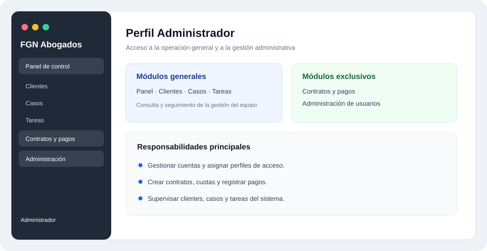
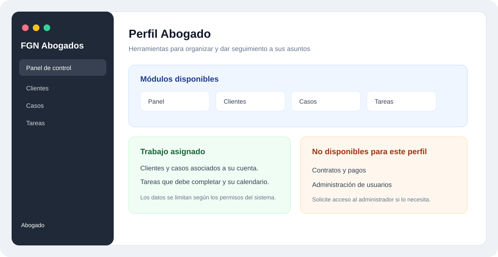
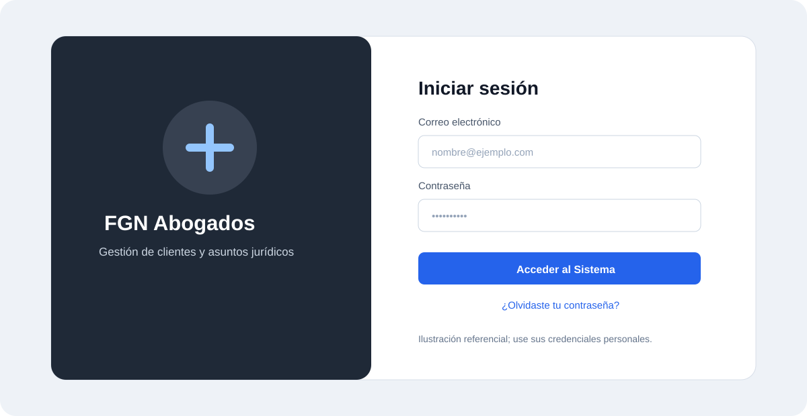
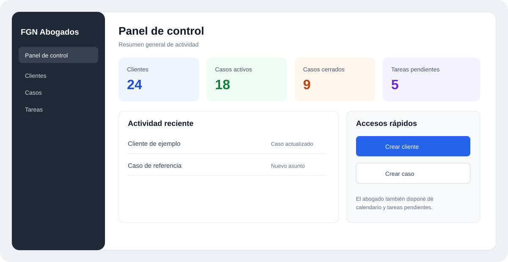
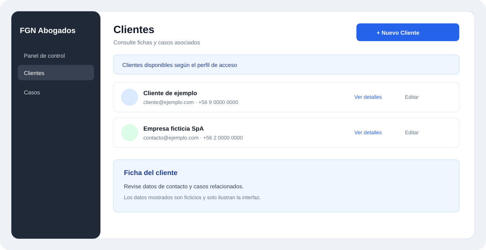
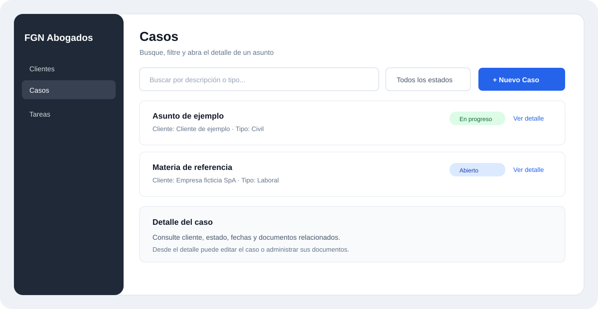
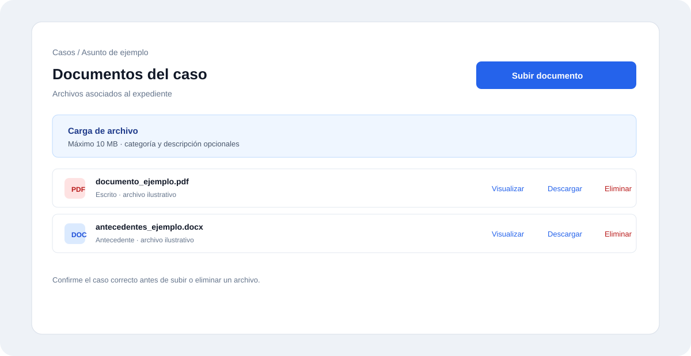
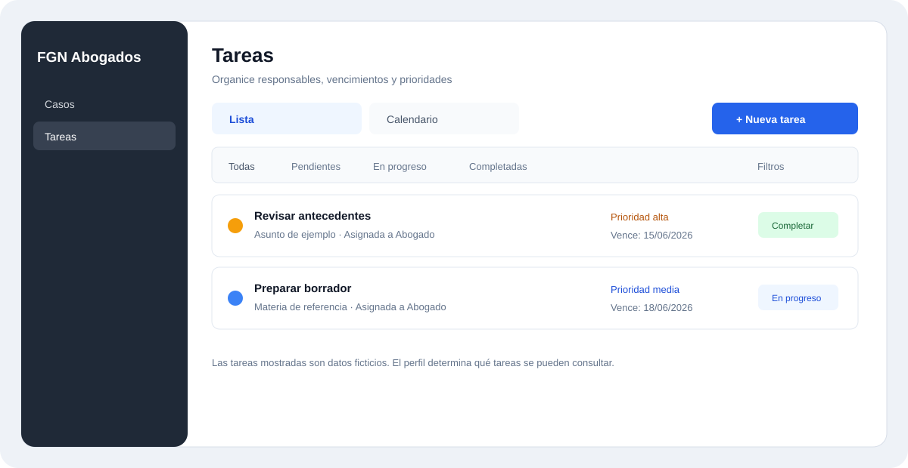
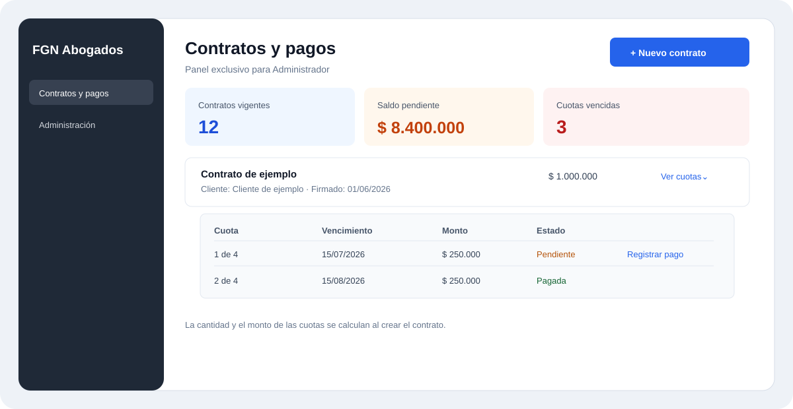
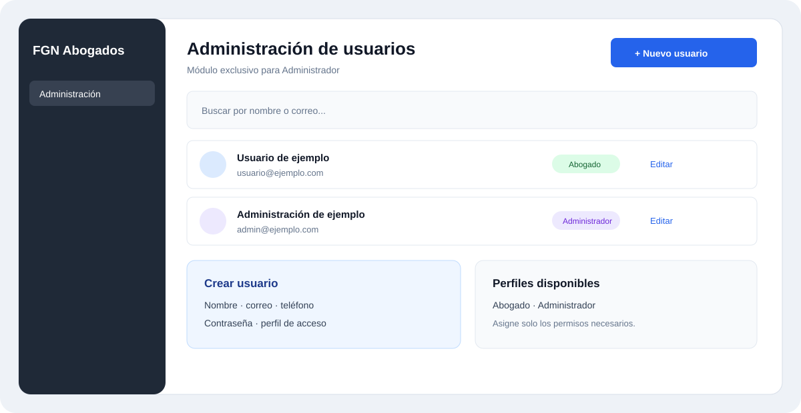

# Manual de usuario — FGN Abogados

Guía práctica de los módulos del sistema y de las funciones disponibles para cada perfil.

> **Imágenes:** las pantallas de este manual son ilustraciones de referencia con datos ficticios; no son capturas de datos reales. La interfaz puede variar ligeramente según el tamaño de pantalla y los permisos de la cuenta.

## 1. Perfiles y permisos

El sistema dispone de dos perfiles operativos:

| Módulo | Administrador | Abogado |
|---|---|---|
| Panel de control | Resumen general de clientes y casos | Resumen de su trabajo y calendario |
| Clientes | Consulta todos los clientes | Consulta los clientes asociados a su cuenta |
| Casos | Consulta y administra todos los casos | Consulta y administra sus casos |
| Tareas | Consulta y administra las tareas del sistema | Consulta las tareas asignadas a su cuenta |
| Contratos y pagos | Acceso completo | Sin acceso |
| Administración de usuarios | Acceso completo | Sin acceso |

### Perfil Administrador

El administrador cuenta con las funciones generales y con los módulos exclusivos para gestionar usuarios, contratos, cuotas y pagos.

### Perfil Abogado

El abogado trabaja con sus clientes, casos y tareas. No tiene acceso a Contratos y pagos ni a Administración de usuarios.

## 2. Acceso al sistema

1. Abra la dirección web proporcionada por la organización.
2. Ingrese su correo y contraseña y presione **Acceder al Sistema**.
3. Use **¿Olvidaste tu contraseña?** si necesita solicitar un enlace para restablecerla.
4. Abra el enlace recibido por correo, defina la nueva contraseña y vuelva a iniciar sesión.
5. Para terminar la sesión, seleccione **Cerrar sesión** en la parte inferior del menú lateral.

## 3. Navegación general

El menú lateral permite abrir los módulos habilitados para el perfil. En pantallas pequeñas, se abre con el botón de menú. El nombre del usuario y su perfil aparecen en la parte inferior.

## 4. Módulos

### 4.1 Panel de control

El panel presenta un resumen del trabajo disponible para la cuenta:

- Cantidad de clientes.
- Casos activos y cerrados.
- Accesos rápidos para crear clientes y casos.
- Clientes y casos recientes.
- Para el abogado, tareas pendientes y un calendario desde el que se puede iniciar la creación de una tarea.

El administrador ve los datos generales de clientes y casos. El abogado ve los datos correspondientes a su trabajo.

### 4.2 Clientes

Desde **Clientes** se puede:

1. Seleccionar **Nuevo Cliente**.
2. Ingresar nombre completo, RUT, correo electrónico y teléfono.
3. Abrir **Ver Detalles** para revisar la ficha del cliente y sus casos asociados.
4. Seleccionar **Editar** para actualizar sus datos.
5. Seleccionar **Eliminar** y confirmar si corresponde.

El administrador ve todos los clientes; el abogado ve los clientes asociados a su cuenta.

### 4.3 Casos

En **Casos** se puede buscar por descripción o tipo y filtrar por estado: Abierto, En progreso, Cerrado o Pausado.

Para registrar un caso:

1. Seleccione **Nuevo Caso**.
2. Elija el cliente, el tipo de caso y el estado.
3. Escriba una descripción e indique la fecha de inicio. La fecha de término es opcional.
4. Guarde el caso.

En cada caso se puede consultar el detalle, editarlo o eliminarlo. El administrador puede consultar todos los casos; el abogado trabaja con los suyos.

### 4.4 Documentos de casos

Los documentos se administran desde el detalle de cada caso.

- Use **Subir** para adjuntar un archivo de hasta 10 MB.
- La categoría y la descripción del documento son opcionales.
- Use las acciones del documento para visualizarlo, descargarlo o eliminarlo.

### 4.5 Tareas

El módulo permite alternar entre **Lista** y **Calendario**, filtrar tareas y revisar su fecha de vencimiento, prioridad, estado, usuario asignado y caso asociado.

Para crear o editar una tarea, complete el título, el caso, la persona asignada, la prioridad y la fecha/hora de vencimiento. Desde la lista se puede marcar una tarea como completada o eliminarla.

- Prioridades: Baja, Media y Alta.
- Estados de uso habitual: Pendiente, En progreso y Completada.
- El administrador puede consultar todas las tareas; el abogado consulta las tareas que tiene asignadas.

### 4.6 Contratos y pagos — solo Administrador

El panel muestra contratos vigentes, saldo pendiente y cuotas vencidas. Permite buscar por cliente o contrato y filtrar por estado.

Para crear un contrato:

1. Seleccione **Nuevo contrato** y elija un cliente registrado.
2. Revise sus datos, ingrese el nombre, descripción, fecha de firma y monto total.
3. Si corresponde, agregue un pago inicial: recibido al firmar o pendiente para una fecha posterior.
4. Seleccione entre 1 y 60 cuotas mensuales e indique la fecha de la primera cuota. El sistema divide el saldo, ajusta cualquier diferencia de pesos en la última cuota y calcula las fechas siguientes en el mismo día de cada mes; si ese día no existe, usa el último día del mes.
5. Revise el resumen y seleccione **Crear contrato**.

Para gestionar pagos, despliegue **Cuotas** en el contrato y elija **Registrar pago** en la cuota correspondiente. Ingrese la fecha y el medio de pago; puede agregar una referencia. También se pueden actualizar los datos generales y el estado del contrato.

### 4.7 Administración de usuarios — solo Administrador

Desde **Administración** se puede consultar la lista de usuarios, crear una cuenta y editar una cuenta existente.

- Al crear una cuenta, ingrese nombre, apellido, correo, teléfono, contraseña y perfil (**Abogado** o **Administrador**).
- Al editar, puede actualizar el correo y el perfil. Para cambiar la contraseña, ingrese una nueva; déjela en blanco para conservar la actual.

## 5. Recomendaciones

- Verifique el cliente y el RUT antes de crear casos o contratos.
- Revise las fechas, montos y cuotas antes de guardar.
- Registre los pagos en la cuota correspondiente para mantener actualizado el saldo.
- Cierre la sesión al terminar, especialmente en equipos compartidos.
- Si una acción falla, revise el mensaje en pantalla y contacte al administrador del sistema.
